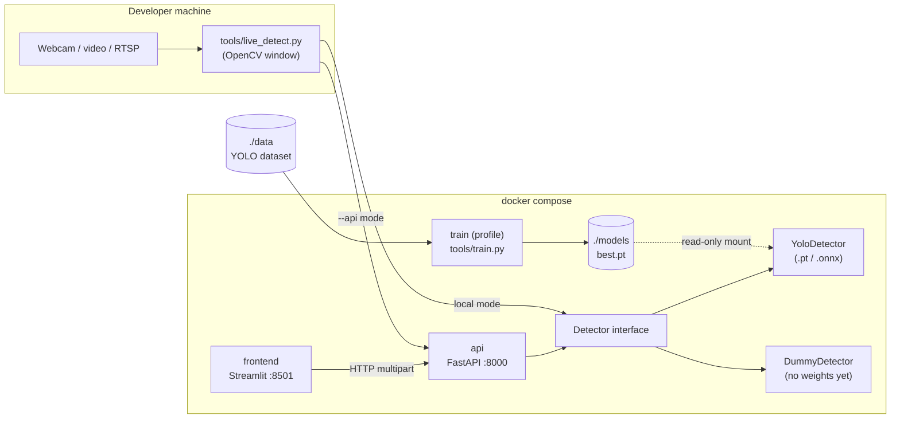

# Architecture

## Current scaffold

Principles:

- **One package, `jass_cv`**, shared by every service. Each Docker image installs only the
  extras it needs: the frontend image has no torch.
- **`Detector` protocol** (`src/jass_cv/detector.py`) is the only seam between "model" and
  "apps". Swapping YOLO for ONNX Runtime or a two-stage pipeline touches one file.
- **`cards.py` is the single source of truth** for class ids and names.
- **The frontend only talks HTTP to the API**, so the API is the product and the UI is one
  client of it (the live tool is another).
- **The dummy detector** lets track B (apps) start before track A (model) delivers.

## Open decisions — to discuss

Each decision lists the options and a recommendation, given **~30 h total and 2 people**.

### D1. Problem formulation — *the most important one*

First, what is the use case? (a) cards lying on the table, e.g. the cards of a trick or a
counted pile, (b) a fanned hand where cards overlap heavily, or (c) both.

| Option | Pros | Cons |
|---|---|---|
| **A. One-stage detector, 36 classes, whole-card box** | simplest, one model, standard tooling | overlapping fanned cards are hard; needs data for every class |
| B. One-stage detector, 36 classes, **corner region** box | works for fanned hands, small boxes and little occlusion | only works if the corner shows the rank and suit clearly enough on *our* deck; small objects need a larger input size |
| C. Two-stage: 1-class "card" detector + 36-class classifier on the crop | classifier is cheap to train, even on synthetic crops; detector needs few labels | two models, more code, crops fail on occluded cards |

**Recommendation:** A, scoped to cards on the table (use case a). Keep C as the fallback
if Under/Ober or 6–9 confusions stay high.

### D2. Model & framework

| Option | Licence | Notes |
|---|---|---|
| **Ultralytics YOLO11 n/s** | AGPL-3.0 | fastest path: training, augmentations, metrics, ONNX export built in. *Already wired in.* |
| RT-DETR (via Ultralytics) | AGPL-3.0 | transformer, often better on small data, slower on CPU |
| RF-DETR (Roboflow) | Apache-2.0 | strong accuracy, permissive licence, newer and less documented |
| torchvision Faster R-CNN | BSD | permissive, but much more code to write |

**Recommendation:** YOLO11n, then YOLO11s if accuracy is short. AGPL is fine for a
school/open-source project. If this ever becomes a closed product, move to RF-DETR.

### D3. Where the training data comes from

| Option | Effort | Notes |
|---|---|---|
| Real photos + manual labels only | high (~1,500 boxes) | most realistic, slowest |
| **Hybrid: synthetic + real** | medium | photograph each of the 36 cards once, cut out, paste onto random backgrounds with rotation/scale/light/occlusion → unlimited auto-labeled data; real photos for val/test |
| Public dataset | low, if one exists | none found yet for Swiss German cards; worth a 15-min search |

**Recommendation:** hybrid. The generator is ~4 h of work and replaces many hours of
labeling. The test set must be real photos.

### D4. Labeling tool

| Option | Notes |
|---|---|
| **Roboflow** (cloud) | fastest UI, model-assisted labeling, versioned exports in YOLO format; free plan makes the dataset public |
| Label Studio (self-hosted) | could be a `labeling` service in our compose; data stays local |
| CVAT | powerful, heavier to run |

**Recommendation:** Roboflow if a public dataset is OK, otherwise Label Studio as a compose
service.

### D5. Training compute

Local GPU (if one of you has NVIDIA), Apple MPS (`--device mps`, works but slower), or
**Colab/Kaggle free GPUs**. The Docker `train` profile is CPU-only and meant for smoke tests.
**Recommendation:** a small Kaggle/Colab notebook that clones the repo and runs
`tools/train.py`.

### D6. Data & model storage

`data/` and `models/` are git-ignored. Options: shared Google Drive / OneDrive (simplest),
Roboflow dataset versions (if D4 = Roboflow), DVC with a remote (proper, but extra tooling),
Hugging Face Hub. **Recommendation:** Roboflow or a shared drive for data; publish weights
as a GitHub Release asset per model version.

### D7. Serving / inference runtime

| Option | Image size | Notes |
|---|---|---|
| PyTorch + Ultralytics in the API *(current)* | large (torch CPU) | zero extra work |
| **ONNX export + onnxruntime** | much smaller | faster on CPU; Ultralytics exports it; needs a small `OnnxDetector` (pre/post-processing + NMS) |

**Recommendation:** ship with PyTorch first, add `OnnxDetector` in track B if time allows.

### D8. Live feed

| Option | Notes |
|---|---|
| **OpenCV desktop tool** *(current)* | simplest, real FPS, also collects training frames |
| streamlit-webrtc in the frontend | live video in the browser; WebRTC adds setup (TURN for remote use) |
| WebSocket endpoint + JS client | lowest latency over the network, most custom code |

**Recommendation:** keep the OpenCV tool for development. Add streamlit-webrtc only if a
live in-browser demo is a requirement.

### D9. Experiment tracking

Ultralytics already writes metrics, plots and the confusion matrix to `runs/`. MLflow or
Weights & Biases add comparison across runs. **Recommendation:** none for 30 h. Keep a short
results table in the README per model version.

### D10. Deployment

Local `docker compose` only, or a hosted demo (Hugging Face Spaces, Render, a small VM)?
This decides whether D7 (image size) and authentication matter.

## Possible extensions (out of scope for 30 h unless they matter)

- Game logic: count the points of the detected cards for a chosen Trumpf / Obenabe / Undenufe.
- Card tracking across video frames (stable ids, no flicker).
- Detect duplicates/missing cards: "which cards of the deck haven't been seen?"
