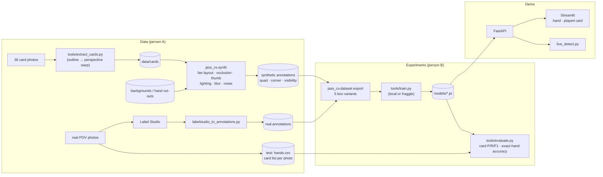

# Architecture

## Goal

Recognise the cards of a **fanned Jass hand, photographed from the player's own point of
view**. The hand holds a variable number of cards (e.g. 9 in Schieber, 12 in three-player
Jass, fewer after playing). A photo taken after each card is played tells which card
it was.

The project is a small **study** with an app as its demo:

> *Can a detector trained only on synthetic images recognise the cards of a real fanned
> hand, and which kind of box is best for heavily overlapping cards?*

## Decisions

| # | Topic | Decision | Why |
|---|---|---|---|
| D1 | Use case | Fanned hand, own POV, variable hand size | One focused, hard CV problem (overlap, rotation, cards that look alike) |
| D2 | What we label | **Compared experimentally** (experiment 2) | Corners are readable but sometimes not enough, so the answer isn't obvious |
| D3 | Training data | **Synthetic** (own generator) + a few real photos | Labels for free, any amount; the generator is our own CV work |
| D4 | Labeling | **Label Studio, self-hosted** (`docker compose --profile label`) | Only needed for the small real set; data stays local |
| D5 | Model | Ultralytics YOLO11n (upright boxes) / YOLO11n-obb (rotated boxes) | Fast path, both box types, same code; AGPL is fine for a course project |
| D6 | Training compute | Same `tools/train.py` locally on Windows (CPU, slow) **or on Kaggle (free GPU)** | No GPU available; experiments need ~8 runs |
| D7 | Serving | PyTorch inside the API, local only | No deployment, so image size doesn't matter |
| D8 | Live view | OpenCV desktop tool now; in-browser live view is a stretch goal | Browser live view is nice-to-have |
| D9 | Data & weights storage | Not in git: shared drive for `data/cards`, `data/real`; weights as GitHub Release assets | Generated data is reproducible from cards + seed |
| D10 | Deliverables | Live demo + final presentation | |

## Pipeline



## The two experiments

### Experiment 1: how well does synthetic data transfer to real photos?

Train the same model (best box variant from experiment 2, or `corner_obb` as default) on:

| Run | Training data |
|---|---|
| 1a | synthetic, `--aug none` (clean renders) |
| 1b | synthetic, `--aug basic` (brightness/contrast) |
| 1c | synthetic, `--aug full` (+ colour temperature, uneven light, blur, noise, shadows, JPEG) |
| 1d | 1c + ~20 real labeled photos |
| 1e | 1c + ~50 real labeled photos |

Optional extra factors: real background photos vs procedural backgrounds; thumb occluder on/off.

### Experiment 2: what should the box cover?

The generator knows the full geometry of every card, so all variants come from **the same
images**. Only the labels differ:

| Variant | Box | Expected trade-off |
|---|---|---|
| `full_aabb` | upright, whole card incl. hidden part | boxes of neighbouring cards overlap almost completely |
| `full_obb` | rotated, whole card | fits rotated cards, still mostly hidden |
| `visible_aabb` | upright, visible part only | honest, but odd shapes (synthetic only) |
| `corner_aabb` | upright, rank/suit corner | small, rarely hidden, but sometimes ambiguous |
| `corner_obb` | rotated, rank/suit corner | probably the best fit for a fan |

Plan for 4 runs (e.g. `full_aabb`, `full_obb`, `corner_aabb`, `corner_obb`). `visible_aabb`
is optional.

### How we measure (identical for all runs)

Different box types can't be compared with box mAP, so the main metric is
**task-level**, on **real photos only** (`tools/evaluate.py`):

- **card precision / recall / F1**: is the predicted set of cards the true hand?
- **exact-hand accuracy**: share of photos where *every* card is right
- with and without telling the model the hand size (`--known-count`)
- per-card recall and likely confusions (Under/Ober, 6–9, suits)

Box mAP on the synthetic validation split is reported as a secondary number.

## Code structure

```
src/jass_cv/
  cards.py        36 classes (single source of truth)
  geometry.py     card quad, corner region, homographies
  synth.py        synthetic fanned-hand generator
  dataset.py      annotation format + export to the 5 YOLO variants
  detector.py     Detector interface: YoloDetector (upright + rotated), DummyDetector
  hand.py         pick the hand (dedupe, top-N), diff two hands, score a hand
  api/main.py     FastAPI: /predict, /predict/annotated, /hand/diff, /classes, /health
  frontend/app.py Streamlit: hand view, "which card was played?"
tools/
  extract_cards.py            card photos → straightened faces
  labelstudio_to_annotations.py
  train.py                    YOLO training (local / Docker / Kaggle)
  evaluate.py                 task-level evaluation on real photos
  live_detect.py              live webcam dev tool
labeling/label_studio_config.xml
```

Principles that stay from the scaffold:

- The **`Detector` interface** is the only seam between model and apps.
- **`cards.py` is the only place class ids are defined**; tests check the Label Studio
  config against it.
- The **frontend only talks to the API**. The dummy detector keeps the apps runnable
  without a model.

## Known limitations / risks

- **Synthetic vs real**: real hands have curved cards, real thumbs and fingers, glare and
  motion blur. Experiment 1 measures how big this gap is; real background photos and hand
  cut-outs (`data/hands/*.png`) are the main levers.
- **Corner definition**: `CORNER_REGION` in `geometry.py` must be tuned to your deck
  (`tools/extract_cards.py` draws it on every card for checking).
- **Fan direction**: the generator assumes cards fanned left to right with each card on top
  of the previous one (the top-left corner stays visible). Mirror it if one of you fans the
  other way.
- **Compute**: ~8–10 training runs. Use Kaggle for the experiments, local CPU for smoke tests.
